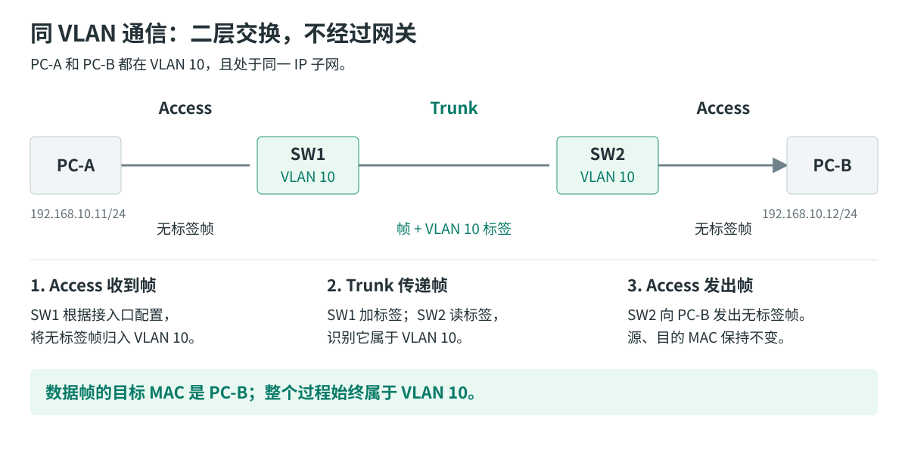
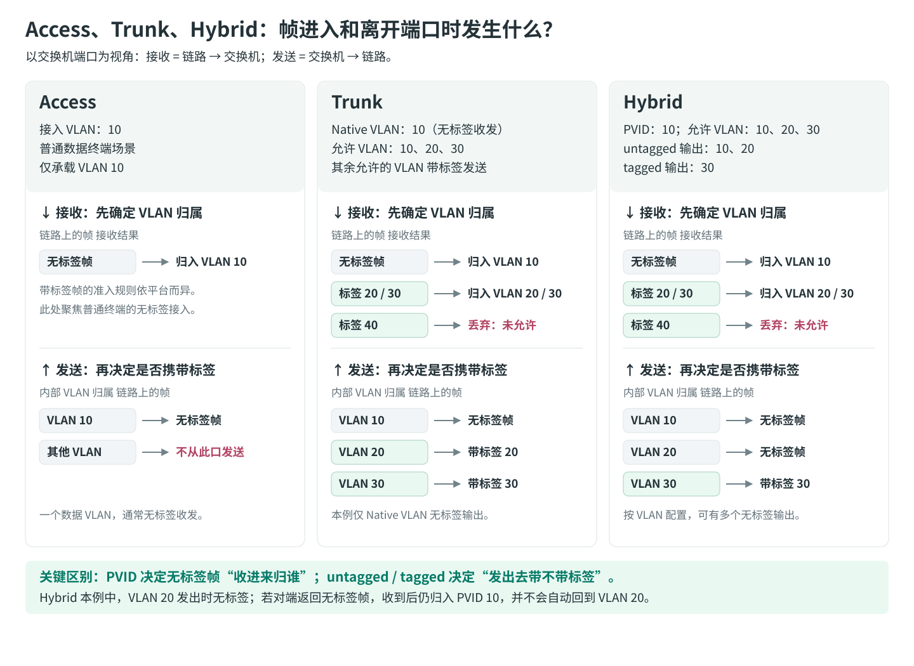
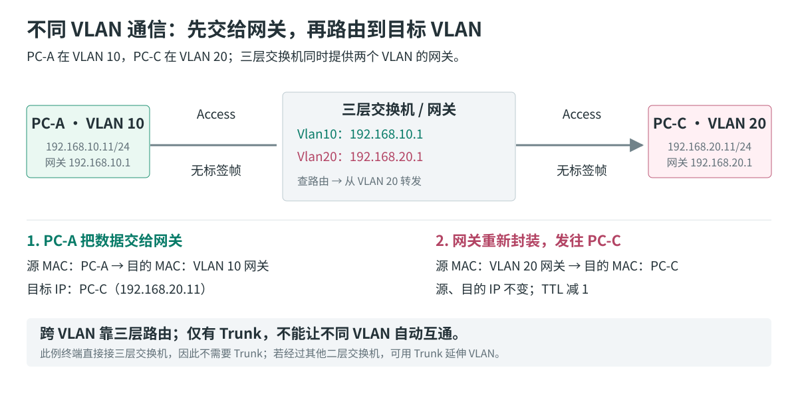

# VLAN：理解二层隔离、Trunk 与跨 VLAN 通信

假设一家公司有研发、财务和访客三类设备，它们连接在同一批交换机上。起初，所有设备都在一个网络里，接上线、配好地址就能使用。随着设备越来越多，管理员开始遇到两个问题：广播流量会传播到不相关的设备，部门之间也缺少清晰的网络边界。

为每个部门单独购买交换机可以解决隔离问题，但设备利用率低，调整工位也不方便。VLAN（虚拟局域网，Virtual Local Area Network）提供了另一种选择：在共用的交换网络中划分逻辑广播域。

## 一、先理解 VLAN 隔离了什么

**VLAN 划分的是二层网络的边界：交换机在一个 VLAN 内转发以太网帧，不会仅靠普通二层交换把帧送入另一个 VLAN。** 因此，即使设备连接在同一台交换机上，也可以属于不同的二层网络。

假设一台交换机连接了四台电脑：研发部的 A、B 和财务部的 C、D。起初，四个接入口都属于同一个 VLAN；现在将 A、B 的接入口划入 VLAN 10，将 C、D 的接入口划入 VLAN 20。网线和交换机都没变，但帧能够到达的范围发生了变化。

| 观察的流量 | 四台电脑在同一个 VLAN 时 | 划分为 VLAN 10 和 VLAN 20 后 |
| --- | --- | --- |
| A 发出的广播帧 | 交换机会向 B、C、D 所在端口转发 | 只向同属 VLAN 10 的 B 所在端口转发，C、D 收不到 |
| A 发给 B 的普通单播帧 | 可以在这个 VLAN 内进行二层转发 | 仍可在 VLAN 10 内进行二层转发 |
| A 发给 C 的普通单播帧 | 可以在这个 VLAN 内进行二层转发 | 不能从 VLAN 10 直接二层转发到 VLAN 20 |

例如，A 查询同一 IP 子网中某个地址对应的 MAC 地址时，会发出 ARP 广播请求。划分 VLAN 后，这份请求只能在 VLAN 10 内传播，C、D 不会收到。**广播传播的二层范围称为广播域；不同 VLAN 属于不同的广播域。**

即使 A 已经知道 C 的 MAC 地址，普通二层交换也不会把 VLAN 10 的帧转发到 VLAN 20：交换机转发时既考虑 MAC 地址，也考虑帧所属的 VLAN。

## 二、跟随一个数据帧走过网络

设 PC-A 和 PC-B 同属 VLAN 10、同一个 IP 子网，但分别连接 SW1 和 SW2。终端连接的是 Access（接入）端口，用于将普通终端的流量归入指定 VLAN；交换机之间使用 Trunk（干道）端口，让一条链路承载多个 VLAN。

本例中，两台交换机的 Trunk 都允许 VLAN 10 通过，并将 VLAN 10 的帧以带标签的形式发送。标签随帧携带 VLAN ID，告诉对端交换机这份流量属于哪个 VLAN。

PC-A 第一次向 PC-B 发送 IPv4 数据时，会先根据自己的地址和掩码判断目标是否位于本地子网。如果属于本地子网且没有目标的 ARP 缓存，就先查询 PC-B 的 MAC 地址。

这份 ARP 请求的路径如下：

1. PC-A 发出无标签广播帧，进入 SW1 的 Access 端口。
2. SW1 根据端口配置，将帧归入 VLAN 10，并学习源 MAC 地址所在的端口。
3. SW1 在 VLAN 10 的相关转发端口上泛洪广播；向 SW2 的 Trunk 发出时，添加 VLAN 10 标签。
4. SW2 识别标签，在 VLAN 10 中转发广播。
5. 帧从连接 PC-B 的 Access 端口发出时不带标签，PC-B 收到请求后回复。

双方建立 ARP 缓存、交换机学习到 MAC 地址后，后续单播帧可以沿对应端口转发。若目的 MAC 暂时未知，交换机通常会在该 VLAN 内泛洪。

## 三、802.1Q：VLAN 标签

### 标签放在哪里

当一条链路承载多个 VLAN 时，接收设备需要从帧中识别 VLAN 归属。802.1Q 提供了一种标准的标签格式：在以太网源 MAC 地址之后、原来的 EtherType/长度字段之前插入 **4 字节（32 位）**，让 VLAN 信息随帧一起传输。

标签携带 VLAN ID、优先级等信息。添加标签不会改变源、目的 MAC 地址或上层数据；在数据和填充长度相同的情况下，帧长增加 4 字节。

### 4 字节标签里有什么

标签由 **TPID（16 位）** 和 **TCI（16 位）** 组成，TCI 再划分为 PCP、DEI 和 VID 三个字段。

| 字段 | 位数 | 作用 | 如何理解 |
| --- | --- | --- | --- |
| TPID（标签协议标识） | 16 | 标识标签类型，普通 802.1Q VLAN 标签通常使用 `0x8100` | 提示接收设备：接下来是标签控制信息，而不是直接进入 IP 等上层数据 |
| PCP（优先级代码点） | 3 | 表示 0～7 的优先级代码，供设备进行流量分类与队列调度 | 用于 QoS；具体待遇由设备策略决定，不会仅凭这个值保证带宽 |
| DEI（丢弃资格指示） | 1 | 标识帧是否具备拥塞时优先丢弃的资格 | 值为 1 不代表立即丢弃；是否丢弃还取决于拥塞情况和策略。旧资料中这一位常称为 CFI |
| VID（VLAN 标识） | 12 | 标识该帧所属的 VLAN | 接收设备用它确定 VLAN 归属，再结合端口准入规则决定是否接收 |

VID 的 12 位可以表示 4096 个数值，但不能理解成可配置 4096 个普通 VLAN：**0 表示优先级标签，不指定普通 VLAN 归属；4095 保留；普通 VLAN ID 通常为 1～4094。** VID 为 0 的帧虽然有标签，但其 VLAN 归属仍需由端口配置等规则确定。具体设备还可能保留部分编号，能够同时支持的 VLAN 数量也受平台限制。

## 四、Access、Trunk 和 Hybrid 的收发规则

前面的报文路径用到了 Access 和 Trunk。第三种常见模式是 Hybrid（混合）：它可以在同一端口承载多个 VLAN，并按 VLAN 配置发送时保留标签还是去掉标签。

比较三种模式时，始终分开看两个问题：**收到帧时，如何确定 VLAN 归属；发送帧时，是否携带标签。**

图中的 Hybrid 将 VLAN 10、20 设为无标签输出，VLAN 30 设为带标签输出；收到的普通无标签帧仍只归入 PVID 10。Trunk 则展示 Native VLAN 10 无标签收发的常见配置。

下表以交换机端口为视角，讨论普通基于端口的 VLAN；Trunk 采用 Native VLAN 无标签收发的常见配置，Hybrid 采用 H3C 风格。

| 收发情况 | Access（接入） | Trunk（干道） | Hybrid（混合） |
| --- | --- | --- | --- |
| 接收无标签帧 | 归入端口配置的接入 VLAN | 归入 Native VLAN / PVID 对应的 VLAN，并须满足端口的 VLAN 准入条件 | 归入 PVID 对应的 VLAN，并须允许该 VLAN 通过；不会按 untagged 输出列表归入多个 VLAN |
| 接收带标签帧 | 是否接收取决于平台及功能配置，不能一概认为全部接收或全部丢弃 | 通常按标签中的 VLAN ID 归类；未允许的 VLAN 丢弃，Native VLAN 的带标签输入规则依平台而异 | 按标签中的 VLAN ID 归类；该 VLAN 在允许列表中则接收，否则丢弃；tagged / untagged 输出配置不用于决定输入帧必须带哪种标签 |
| 发送允许通过的 VLAN 帧 | 普通接入 VLAN 的帧以无标签形式发出 | Native VLAN 的帧通常无标签发出；其他允许的 VLAN 携带对应标签发出 | 按该 VLAN 的输出配置处理：tagged 带标签发出，untagged 无标签发出 |
| 发送不属于端口允许范围的 VLAN 帧 | 不从此端口发出 | 不从此端口发出 | 不从此端口发出 |
| 可以无标签输出几个 VLAN | 普通数据接入场景中为一个 | 本表所示配置中为一个 Native VLAN | 可以为多个，但无标签输入仍只归入一个 PVID |

## 五、不同 VLAN 如何通信

不同 VLAN 是相互隔离的二层网络。要让它们通信，需要一台具有**三层路由功能**的设备同时连接相关 VLAN，作为各 VLAN 的网关，并根据目标 IP 地址将数据转发到目标网络。普通二层交换机和 Trunk 本身都不提供跨 VLAN 路由：Trunk 只是让一条链路承载多个 VLAN 的流量。

通常，每个 VLAN 对应一个 IP 子网，并配置该子网的网关地址。终端发现目标 IP 不在本地子网时，会把数据发送给默认网关；网关查询路由，选择通往目标子网的出口，再将数据送入对应的 VLAN。通信双方还需要正确配置 IP 地址、子网掩码和网关，路由设备需要有往返路由，访问控制策略也必须允许该流量。

### 常见的实现方式

| 方式 | 工作方式 | 使用时需要关注 |
| --- | --- | --- |
| 单臂路由 | 路由器通过一条 Trunk 连接交换机，用不同子接口分别接入不同 VLAN，并为各子网提供网关 | 跨 VLAN 流量共享该物理链路及路由器处理能力 |
| 三层交换机 | 为各 VLAN 创建 SVI（VLAN 三层接口），配置网关地址并启用路由 | 设备功能、接口状态和访问控制策略 |

例如，单臂路由中可以用 `encapsulation dot1Q 10` 将一个路由器子接口关联到 VLAN 10，再为该子接口配置网关地址。完整示例及平台说明见 [Cisco 外部路由器实现 VLAN 间路由](https://www.cisco.com/c/en/us/support/docs/lan-switching/inter-vlan-routing/14976-50.html)。

### 举例：通过三层交换机通信

图中 PC-A 和 PC-C 分别通过 Access 端口连接三层交换机，属于 VLAN 10 和 VLAN 20，两侧链路上的帧均不带标签。假设 VLAN 10 使用 `192.168.10.0/24`，VLAN 20 使用 `192.168.20.0/24`，交换机上分别配置了两个子网的网关接口。

PC-A 访问 PC-C 时，数据经过以下过程：

1. PC-A 根据子网掩码判断 PC-C 不在本地子网，于是将 IP 包交给默认网关。它通过 ARP 获取 VLAN 10 网关的 MAC 地址，并以该地址为目的 MAC 发送帧。
2. 网关接收 VLAN 10 的帧，移除二层头部和尾部，取出 IP 包。它查询路由，确定目标地址应从 VLAN 20 转发。
3. 网关为 IP 包构造新的二层帧：源 MAC 是 VLAN 20 网关的 MAC，目的 MAC 是 PC-C 的 MAC；若尚不知道 PC-C 的 MAC，网关会在 VLAN 20 中通过 ARP 查询。新帧从连接 PC-C 的 Access 端口无标签发出。
4. PC-C 回复时，同样通过自己的默认网关，沿反方向完成路由转发。

因此，跨 VLAN 转发不是把原来的 VLAN 10 标签改成 VLAN 20，而是“VLAN 10 帧 → 网关解封装 → IP 包 → 新建 VLAN 20 帧”。如果新帧经 Trunk 发出，是否携带 VLAN 20 标签取决于端口配置。正常路由转发过程中，IP 源、目的地址通常保持不变，TTL 减一；二层源、目的 MAC 则按新的链路重新填写。这里假设没有 NAT 或隧道等额外处理。
