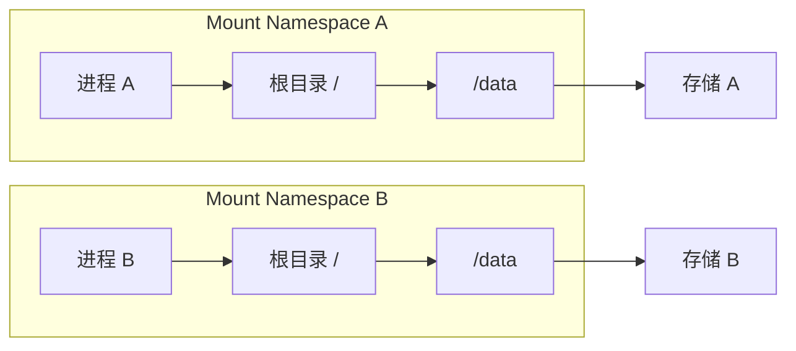
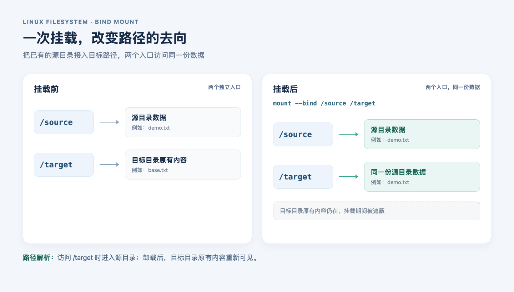

# 从 Linux 文件系统理解 Docker：文件写入、重启与挂载

在容器中执行：

```sh
printf 'hello\n' > /data/demo.txt
```

这条命令写入的路径虽然固定，数据却可能进入容器的可写层、宿主机目录或 Docker volume。存储位置不同，容器重启或删除后数据的保留情况也不同。

要理解其中的区别，先要看容器进程如何找到 `/data/demo.txt`：它看到的目录树从哪里来，路径又是如何指向实际存储的？

## 一、容器为什么有自己的目录树？

Linux 进程从自己的根目录开始解析绝对路径，沿目录逐级查找；遇到挂载点时，便进入挂载在此处的文件系统。因此，要知道 `/data/demo.txt` 指向哪里，首先要知道进程看到的是哪棵目录树。

Mount Namespace 隔离进程所见的挂载列表。容器运行时通过组织挂载并设置进程的根目录，让容器看到自己的目录树。



图中，两个进程访问相同的 `/data` 路径，却可以到达不同的存储。不同的 Mount Namespace 也可以挂载同一份存储；它隔离的是挂载关系，而不是数据本身。

## 二、OverlayFS 如何管理容器文件？

OverlayFS 是 Linux 的联合文件系统：它把多个目录层叠起来，对外呈现为一棵合并后的目录树。下层（`lowerdir`）提供基础内容，上层（`upperdir`）保存变化，进程通过合并视图（`merged`）访问文件。当上下层有同名文件时，合并视图优先显示上层的版本。

Docker 可以利用这种分层机制管理镜像和容器的文件：镜像层作为只读下层，多个容器可以共享；每个容器另有自己的可写上层。容器创建文件时，文件写入上层；首次修改只存在于下层的文件时，OverlayFS 会先将文件复制到上层，再进行修改，这称为**写时复制**（copy-up）。删除下层文件时，OverlayFS 会在上层记录一个遮蔽标记，使该文件不再出现在合并视图中，而不是修改只读镜像层。

因此，写入容器根文件系统的文件变化属于该容器的可写层。停止并重新启动同一个容器时，可写层仍然保留；删除容器时，可写层也随之移除。即使用同一镜像创建新容器，它也会获得自己的可写层，不会继承旧容器的修改。挂载到容器中的目录或 volume 有独立的存储生命周期，下面会进一步说明。

## 三、bind mount：让容器访问已有目录

Linux 的 bind mount 可以将已有目录绑定到另一个路径，使进程通过目标路径访问该目录：

```sh
mount --bind /source /target
```

这相当于为同一目录树增加一个访问入口，并不会复制文件。



挂载后，访问 `/target` 会进入源目录；目标目录原有内容仍在，只是在挂载期间被遮蔽。

Docker 将宿主机目录绑定到容器的 `/data` 后，容器在该目录中的写入会进入源目录，宿主机和容器可以通过不同路径访问同一份数据。删除容器不会删除源目录。

同样，挂载到容器的 `/data` 会遮蔽镜像中该目录的原有内容；不带该挂载创建容器时，镜像中的文件仍可见。[Docker：Bind-mounting over existing data](https://docs.docker.com/engine/storage/bind-mounts/#bind-mounting-over-existing-data)

## 四、volume：由 Docker 管理的独立存储

具名 volume 是独立于容器的存储资源。使用默认本地驱动时，Docker 管理数据目录，并将它挂载到容器指定路径。

写入 volume 的数据独立于容器可写层。普通删除容器操作会保留具名 volume；新容器挂载同一个 volume 后，可以继续访问其中的数据。

默认情况下，空 volume 挂载到容器中已有内容的目录时，Docker 会先将目录内容复制进空卷。这是 Docker 的初始化行为，而非 Linux 挂载本身的行为；使用 `volume-nocopy` 可以关闭复制。[Docker：Mounting a volume over existing data](https://docs.docker.com/engine/storage/volumes/#mounting-a-volume-over-existing-data)

## 五、如何判断数据是否保留？

| 操作 | 容器可写层 | bind mount 源目录 | 具名 volume |
| --- | --- | --- | --- |
| 停止并启动原容器 | 保留 | 保留并重新挂载 | 保留并重新挂载 |
| 普通删除容器 | 移除 | 保留 | 保留 |
| 新容器访问旧数据 | 不会自动继承 | 指定原源目录 | 指定原 volume |
| 主动清理数据 | 删除容器 | 删除源目录中的数据 | 删除 volume |

判断文件是否会保留，先确认路径指向容器可写层还是某个挂载，再确认相应操作是否会删除这份存储。
